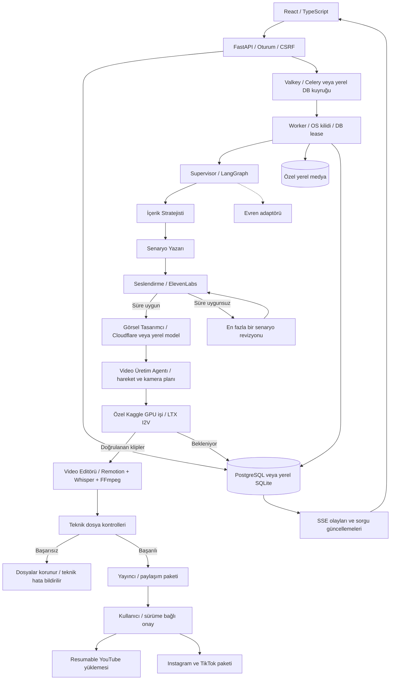

# Sahne mimarisi

Yeni üretimler (`pipeline_version=2`) Supervisor ve yedi uzmandan oluşur. Rol kataloğu `shared/agents.json` dosyasındadır; teknik kalite kontrolü ve insan onayı agent sayısına dahil değildir. Eski üretimler sürüm 1 akışını ve yedi rolünü korur. Metin/medya metin modelleri `providers.py` üzerinden seçilir. Ses, süre kontrolü, görseller, hareket ve kurgu sıralı çalışır. Başarılı aşamalar doğrulama sonrası `Run.outputs` içine kalıcı yazılır; devam ederken tamamlanan aşamalar atlanır. Bu davranış LangGraph'ın bellek içi checkpointer'ına bağımlı değildir.

## Araçların bulunduğu dosyalar ve agentic davranışın sınırı

Eski v1/v2 sürümleri sabit LangGraph düğümleri içinde model kararları kullanan **kontrollü agentic iş akışıdır**. Model senaryo, ses seçimi, hareket/kamera ve izinli kurgu kararları üretir; şema doğrulama, gerçek süre ölçümü, koşullu yönlendirme ve sınırlandırılmış düzeltme döngüleri vardır. Sonraki aracı ve agentı Python akışı seçer. LLM'ye `tools`/`tool_choice` gönderilen, modelin araç çağrılarını seçerek observation → decision → action döngüsü yürüttüğü otonom bir tool-calling yürütücüsü henüz yoktur. Supervisor da dinamik agent delegasyonu yapmaz. Katalogdaki `tool` alanı arayüz açıklamasıdır; çalıştırılabilir araç kaydı değildir.

| Dosya | Gerçek görevi |
|---|---|
| [pipeline.py](../backend/app/pipeline.py) | `run_stage` ile araçları çağırır; `build_graph` bağımlılıkları ve düzeltme yollarını tanımlar. |
| [providers.py](../backend/app/providers.py) | Şemalı LLM yanıtı, RSS ve resmî YouTube araştırması. |
| [voice_selection.py](../backend/app/voice_selection.py) | Ses adayları, önizleme değerlendirmesi ve doğrulanan seçim. |
| [media_providers.py](../backend/app/media_providers.py) | Cloudflare ve ElevenLabs HTTP adaptörleri. |
| [media.py](../backend/app/media.py) | Medya üretimi, süre ölçümü, altyazılar, FFmpeg ve dosya denetimi. |
| [motion.py](../backend/app/motion.py) | Gerçek ses sürelerine bağlı çekim dağılımı ve modelden hareket planı. |
| [kaggle_provider.py](../backend/app/kaggle_provider.py) | Özel girdi yükleme, iş gönderme, sorgulama, durdurma ve doğrulanan klip indirme. |
| [generate.py](../backend/kaggle/generate.py) | Kaggle içinde çalışan görüntüden videoya model çıkarımı. |
| [remotion_renderer.py](../backend/app/remotion_renderer.py) | Doğrulanan kurgu kararlarını Remotion renderına ve FFmpeg ses miksajına dönüştürür. |
| [youtube.py](../backend/app/youtube.py) | Güncel sürüm onayına bağlı yayın işlemleri. |

Agent çıktıları çalıştırılabilir kod değildir. Hareket ve kurgu sözleşmeleri `schemas.py` içindedir. Kanonik isim/görev kataloğu `shared/agents.json`, frontend eşlemesi `frontend/src/agents.ts`, backend aşama listesi `backend/app/agents.py` içindedir.

Kota/bağlantı hatası bekletme veya başarısız durum oluşturur. Kaggle işi `RemoteJob` kaydıyla takip edilir; `waiting_remote` sırasında yerel worker kilidi bırakılır. Hesap başına tek uzak iş ve belirsiz gönderimi tekrar etmeme kuralı vardır. Başarılı çekimler korunur, başarısız çekimlere en fazla bir ek deneme yapılır. İptal edilen üretim için resmî API'den uzak durdurma istenir; Kaggle `CANCEL_ACKNOWLEDGED` veya başka son durum bildirmeden hesap yuvası serbest bırakılmaz. Eski/iptal sonuçlar montaja alınmaz. Deterministik model yapılandırma hatasında aynı ayarla ikinci GPU denemesi yapılmaz. Düzeltmeden sonra başarısız hareket aşamasını kullanıcı yeniden denerse yeni motor sürümüyle ses/görseller korunarak devam edilir.

İptal medya alt süreçlerinde ve diffusion adımlarında kontrol edilir. Devam eden HTTP/TTS çağrısında iptal çağrı tamamlandığında uygulanabilir. Worker ölünce yeni üretimlerin checkpoint'leri korunup otomatik devam edilir; eski sürüm işler kullanıcı tekrarına bırakılır. Dosya kilidi aynı diski paylaşan worker süreçlerinde tek ağır iş kuralını korur. Sağlayıcı ayarları üretim başında saklanır; anahtarlar snapshot'a veya arayüze taşınmaz.

Onay manifesti: run kimliği + revizyon + video/altyazı/kapak hash'leri + paylaşım metni. Sonraki revizyon onayı geçersiz kılar. Yayın işi run başına benzersizdir. YouTube upload URL, byte offset ve video ID kalıcıdır. Belirsiz sonuçta önce aynı oturum sorgulanır, yeni upload başlatılmaz.

Yerel pilot sürekli açık sunucu garantisi vermez. Çok sunuculu worker ölçeklemesi için dosya kilidi yerine dağıtık fencing ve ortak nesne deposu ayrıca tasarlanmalıdır; mevcut sürüm bunu iddia etmez.

## Otonom üretim v3

Yeni üretimler konu promptundan başlar. MiMo Supervisor uygun uzmanı dinamik seçer; uzmanlar kayıtlı araçları gözlem/karar/eylem döngüsünde kullanır. Editör önizleme, görsel değerlendirme, gerekirse plan düzeltmesi ve final render araçlarını seçer. Kalıcı görev sonuçları, bağımlılık denetimleri ve bütçeler veritabanında korunur. Doğal dil geri bildirimi hedefli ve yeniden onay gerektiren sürümlere dönüşür. Ayrıntı: [Otonom video akışı](agentic-video.md).
